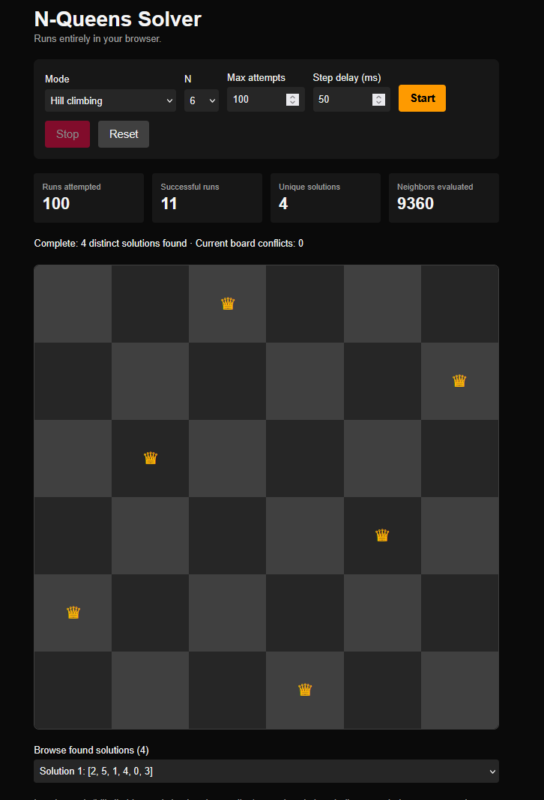

# N-Queens Solver

An interactive N-Queens solver built with **Next.js**. It compares two local-search algorithms, hill climbing and simulated annealing, with exhaustive backtracking search. The search runs in a Web Worker, so the UI stays responsive and you can watch the board update live.

**Live demo:** _https://n-queen-local-search-bpir-six.vercel.app/_




## Features

- **Three solving modes**
  - **Hill climbing**: steepest-ascent with random restarts.
  - **Simulated annealing**: random neighbor moves, Metropolis acceptance, geometric cooling and restarts.
  - **Exhaustive (all solutions)**: row-by-row backtracking that finds every solution.
- Live board visualization with a configurable step delay
- Statistics: runs attempted, neighbors evaluated, placements tried, solutions found, unique solutions
- Browse the solutions that were found
- Runs in a Web Worker (`public/nqueens.worker.js`), so the page doesn't freeze

## Algorithms

### Hill climbing
Starts from a random board with one queen per column. It evaluates all neighbors (moving one queen within its column) and moves to the best one only if it strictly reduces conflicts. When it reaches a local optimum, it restarts from a new random board, up to the maximum number of attempts.

### Simulated annealing
Picks a random neighbor each step. It always accepts a move that doesn't increase conflicts. Otherwise it accepts with probability `exp(-Δ / T)`. The temperature decays as `T ← T × cooling` on every step. Each run is capped at 5000 moves, then restarts.

| Parameter | Default | Meaning |
|---|---|---|
| Start temperature | 2 | Initial `T`. Higher values accept more bad moves. |
| Cooling rate | 0.999 | Multiplier applied to `T` every step. |

### Exhaustive search
Backtracking that places one queen per row. It tracks used columns and both diagonals in O(1) arrays, so invalid partial boards are pruned immediately. It finds every solution (92 for N=8).

## Tech stack

- [Next.js](https://nextjs.org/) (App Router)
- React
- TypeScript
- Web Workers

## Getting started
```bash
git clone https://github.com/MR-Abbasnejad/n-queen-local-search.git
cd n-queen-local-search
npm install
npm run dev
